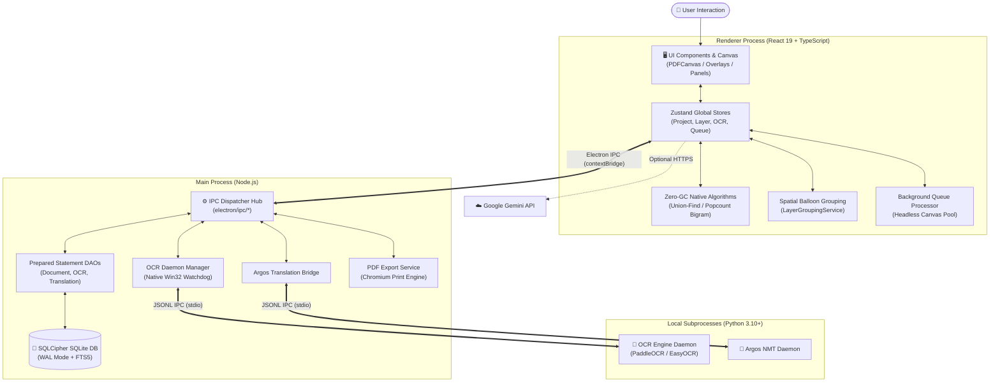

# System Architecture (HLD)

## 1. System Overview & Tech Reality
- **System Type:** Local-first Desktop Application (Manga & Document OCR/Translation Engine)
- **Runtime & Constraints:** Electron 39 (Node.js 20+ Main Process + Chromium Renderer Process with React 19) ผสาน Local Python 3.10+ Subprocess Daemons ประมวลผลแบบ Offline 100% บนเครื่องผู้ใช้
- **Core Architecture Style:** Multi-tier Asynchronous Process Pipeline (Renderer UI ↔ Electron Typed IPC ↔ Python Daemon Subprocesses ↔ SQLCipher Local Storage)
- **Implementation Status:** Implemented (ระบบ OCR, Translation, Spatial Graph Clustering, Database DAOs, และ Document Export ใช้งานได้จริงและผ่าน Test Suite 100%)

---

## 2. High-Level Architecture Diagram



---

## 3. Core Subsystems & Boundaries

### 3.1 Renderer Process Subsystem (Presentation & Client State)
- **Boundary:** Chromium Browser Window (`src/`)
- **Responsibility:** เรนเดอร์หน้าเอกสาร PDF/รูปภาพผ่าน PDF.js, แสดงผล Interactive Text Layer Overlays, รับการแก้ไขตำแหน่งและคำแปลจากผู้ใช้, และควบคุมสถานะ UI
- **Depends On:** `electron/preload.ts` (`window.electronAPI`), `pdfjs-dist`, `zustand`
- **Boundary Rules:** ห้ามเข้าถึง Node.js Runtime, File System หรือ SQLite Database โดยตรง ทุกการติดต่อ I/O ต้องผ่าน IPC Bridge
- **Implementation Status:** Implemented

### 3.2 Native Algorithms & Spatial Grouping Subsystem
- **Boundary:** `src/services/native/` & `src/services/layers/` & `src/services/layout/`
- **Responsibility:** คำนวณขอบเขต Bounding Box ด้วย Disjoint-Set Union-Find (Zero-GC บน `Int32Array`), ทำ Bigram Deduplication ด้วย Popcount Bitset, และจัดกลุ่มบอลลูนคำพูด 2 มิติ
- **Depends On:** TypedArray Buffers (`Int32Array`, `Uint32Array`), Bounding Box Coords
- **Boundary Rules:** ห้ามจอง Heap Memory ภายใน Hot Execution Loop เพื่อขจัด Garbage Collection Spikes; ห้ามเรียก I/O ระหว่างการคำนวณ Clustering
- **Implementation Status:** Implemented

### 3.3 Main Process Subsystem (System Coordination & IPC Hub)
- **Boundary:** Node.js Runtime (`electron/`)
- **Responsibility:** จัดการ Window Lifecycle, รวมศูนย์ตัวจัดการ IPC (`electron/ipc/`), บริหาร Process Watchdog, ตรวจสอบสิทธิ์และ PIN ผ่าน `authService.ts`, และเข้าถึง File System
- **Depends On:** `electron`, `better-sqlite3-multiple-ciphers`, Node `child_process`
- **Boundary Rules:** ห้ามรันงาน CPU-bound OCR หรือ Translation บน Main Thread; ห้าม Expose Database Connection Instance ข้ามไปยัง Renderer
- **Implementation Status:** Implemented

### 3.4 Data Storage Subsystem (SQLCipher & Modular DAOs)
- **Boundary:** `electron/db.ts` & `electron/dao/`
- **Responsibility:** จัดการการเชื่อมต่อฐานข้อมูล SQLite เข้ารหัส (256-bit AES), รัน Migration, ทำ FTS5 Search, และแคชคำสั่ง SQL ผ่าน Prepared Statement Cache
- **Depends On:** `better-sqlite3-multiple-ciphers`
- **Boundary Rules:** รันใน Main Process เท่านั้น; การเข้าถึงข้อมูลต้องผ่าน DAO Methods ห้ามยิง Dynamic Raw SQL จากภายนอก
- **Implementation Status:** Implemented

### 3.5 OCR Execution Subsystem (Python Bridge)
- **Boundary:** `electron/ocrDaemonManager.ts`, `electron/ocrBridge.ts` & `scripts/external_ocr_bridge.py`
- **Responsibility:** ดูแลวงจรชีวิตของ Python Daemon, จัดการคิวงาน OCR, ดักจับข้อผิดพลาดและตรวจวัด Liveness ผ่าน `process.kill(pid, 0)`, และสลับ Fallback อัตโนมัติ (PaddleOCR -> EasyOCR)
- **Depends On:** Python Virtualenv (`.venv-ocr`), PaddlePaddle, PaddleOCR, EasyOCR
- **Boundary Rules:** สื่อสารผ่าน JSON Lines ผ่าน Stdio เท่านั้น; กักกันข้อผิดพลาดของ Python ไม่ให้กระทบ Main Process
- **Implementation Status:** Implemented

### 3.6 Translation Subsystem (Offline NMT & Dictionaries)
- **Boundary:** `electron/argosBridge.ts`, `scripts/argos_translate_bridge.py` & `src/services/translation/`
- **Responsibility:** แปลประโยคออฟไลน์ผ่าน Argos Translate Daemon, ค้นหาพจนานุกรมคำสั้น/สแลงเฉพาะทาง, กรอง Carryover ภาษาต้นทาง, และเชื่อมต่อ Gemini API สำรอง
- **Depends On:** Argos Translate Python Subprocess, ตารางพจนานุกรมภาษาไทย/สเปน/เกาหลี/อังกฤษ, Gemini REST API
- **Boundary Rules:** ยึดการทำงานแบบ Offline-first; กรอง Hallucination และอักขระ CJK แปลค้างก่อนส่งผลลัพธ์กลับสู่ Renderer
- **Implementation Status:** Implemented

### 3.7 Document Export Subsystem
- **Boundary:** `src/export/`, `src/hooks/useExportOrchestration.ts` & `electron/pdfExportService.ts`
- **Responsibility:** ประกอบภาพต้นฉบับความละเอียดสูงเข้ากับเลเยอร์ข้อความแปล, เรนเดอร์หน้าพิมพ์แบบ Headless, และส่งออกเป็นไฟล์ PDF หรือรูปภาพ
- **Depends On:** Chromium Headless Print Window (`printToPDF`), `pdf-lib`
- **Boundary Rules:** ทำงานในหน้าต่างแยกหรือเบื้องหลังเพื่อไม่บล็อกการใช้งาน Canvas หลัก
- **Implementation Status:** Implemented

---

## 4. Primary Data Flows & State Lifecycle

### 4.1 On-Demand Single Page OCR & Grouping Flow
```text
User Navigate Page -> BackgroundQueueProcessor.runSinglePageOCR()
  -> IPC (ocr:process-page) -> OCRCacheDAO (Check DB Cache)
    -> [Cache Miss] -> Python Daemon (PaddleOCR BBoxes) -> Save to OCRCacheDAO
  -> Renderer Receives OCR -> LayerGroupingService (Zero-GC Union-Find Clustering)
  -> useOCRTextLayerStore & useLayerStore Updated -> Canvas Overlay Rendered
```
*คำอธิบาย:* เมื่อเปิดหน้าเอกสาร ระบบจะค้นหาผลลัพธ์ OCR จาก SQLite ก่อน หากไม่พบค่อยส่งภาพเข้า Python Daemon มาจัดกลุ่มเป็นบอลลูนคำพูดและวาดซ้อนทับบนหน้ากระดาษ

### 4.2 Offline Batch Translation Flow
```text
Prepared Text Groups -> translationCoordinator -> phraseCache / SentenceTranslationDAO Check
  -> [Uncached Sentences] -> IPC (translation:translate-batch) -> Python Argos Daemon
  -> Quality & Hallucination Guard -> Save to TranslationCacheDAO & SentenceTranslationDAO
  -> Synchronize to useLayerStore -> Interactive Text Layers Displayed
```
*คำอธิบาย:* ข้อความที่จัดกลุ่มแล้วจะถูกตรวจเช็คแคชระดับประโยค ประโยคใหม่จะส่งเข้า Argos Daemon จากนั้นผ่านระบบตรวจสอบคุณภาพก่อนบันทึกลงฐานข้อมูลและอัปเดตเลเยอร์

### 4.3 Background Whole-Document Processing Flow
```text
User Enqueues Job -> BackgroundQueueProcessor -> Reusable Headless Canvas Pool (Render N+1)
  -> Prefetch Pipeline -> Execute OCR & Translation -> Direct DB Writes (Isolate Non-active Doc)
  -> LocalStorage Queue Persisted -> Job Completed
```
*คำอธิบาย:* คิวงานเบื้องหลังสลับใช้ Reusable Canvas Pool เรนเดอร์หน้าถัดไปล่วงหน้า และบันทึกผลลง SQLite โดยตรงโดยไม่แทรกแซง In-Memory Store ของหน้าที่ผู้ใช้กำลังเปิดอ่านอยู่

### 4.4 State Ownership
- **UI / Client State:** อยู่ใน React Component State (`useState`, `useRef`) รับผิดชอบสถานะชั่วคราว เช่น พิกัดการลาก Bounding Box, การขยาย Zoom, และการเปิด/ปิด Context Menu
- **Application / Global State:** อยู่ใน Zustand Stores (`src/stores/`) มีหน้าที่ถือสถานะร่วมของระบบ เช่น `useProjectStore` (เอกสารที่กำลังเปิด), `useLayerStore` (เลเยอร์คำแปลปัจจุบัน), `useBackgroundQueueStore` (รายการคิวงาน)
- **Persistent State:**
  - *ฐานข้อมูลหลัก:* SQLite DB เข้ารหัสผ่าน SQLCipher เก็บประวัติเอกสาร, โครงสร้างโปรเจกต์, แคช OCR, และแคชคำแปล
  - *สถานะเซสชัน UI:* `localStorage` (Zustand persist) บันทึกคิวงานที่ค้างอยู่และการตั้งค่า Viewport

---

## 5. Storage & External Integrations

- **Storage / Database:**
  - *เทคโนโลยี:* SQLite 3 ผ่าน `better-sqlite3-multiple-ciphers` รองรับ SQLCipher 256-bit AES
  - *โหมดการทำงาน:* WAL (Write-Ahead Logging), Memory-mapped I/O 128MB, Page Size 4096, FTS5 Full-Text Index
  - *Data Access Boundary:* รวมศูนย์อยู่ที่ `electron/dao/` โดยเชื่อมต่อผ่าน Main Process เท่านั้น
- **External Services & Integrations:**
  - *PaddleOCR / EasyOCR:* Local Subprocess ผ่าน JSON Lines IPC พร้อมระบบ Watchdog ตรวจสอบ Process Liveness
  - *Argos Translate:* Local Subprocess ผ่าน JSON Lines IPC สำหรับ NMT ออฟไลน์
  - *Google Gemini API:* บริการออนไลน์ภายนอก (HTTPS REST) ทำงานเป็นทางเลือกเสริมเมื่อผู้ใช้ระบุ API Key
- **Integration Failure Considerations:**
  - หาก Python Subprocess ดับ ระบบ Watchdog จะรีสตาร์ตกระบวนการใหม่ทันที
  - หากโมเดลหลัก (PaddleOCR) ล้มเหลว มีระบบ Fallback ไปยัง EasyOCR
  - หากระบบ NMT ไม่พร้อมใช้งาน มีพจนานุกรมสำรอง (Fallback Dictionaries) ป้องกันระบบค้าง

---

## 6. Technical Debt & Prototype Limitations

- **Tight Coupling:**
  - `[Resolved]` `LayerGroupingService.ts`: ขจัดโค้ดดักพิกัดเฉพาะกรณี `if (ocrResult.pageNumber === 5)` ออกจาก Production Code เรียบร้อยแล้ว โดยย้ายการจัดเรียงพิกัดที่สมจริงเข้าสู่ Test Fixture โดยตรง
  - `BackgroundQueueProcessor.ts` มีความรับผิดชอบหลายด้านรวมกัน (เรนเดอร์ Headless Canvas, ประสานงาน IPC, จัดการ Prefetch, และซิงค์ Store) ทำให้ไฟล์มีขนาดใหญ่กว่า 50KB
- **Prototype Shortcuts:**
  - `useDocumentTranslation.ts` มีขนาดโค้ดกว่า 40KB (800+ บรรทัด) ทำหน้าที่เป็น Orchestrator ครอบคลุมทั้ง Single-page, Batch, Error Retries, และ Layer Sync
- **Missing Abstractions:**
  - พาธของ Python Environment ใน `pythonRuntime.ts` อิงจากโฟลเดอร์ตายตัว (`.venv-ocr`, `.venv`) หากสภาพแวดล้อมของผู้ใช้แตกต่างออกไป ต้องพึ่งพาการระบุผ่าน `OCR_PYTHON_PATH` ใน `.env` เท่านั้น
- **State Ownership Issues:**
  - ผลการแปลมีสถานะซ้ำซ้อน 2 จุดระหว่าง `useOCRTextLayerStore` (แคชคำแปลระดับหน้า) กับ `useLayerStore` (เลเยอร์คำแปลสำหรับเรนเดอร์) ทำให้ต้องมีขั้นตอน Synchronization เพื่อป้องกัน State Desynchronization

---

## 7. High-Risk Change Zones

- **Area:** `src/types/index.ts` & `src/types/electron.d.ts`  
  -> **Why Risky:** สัญญาหลักของการสื่อสารข้ามโพรเซส (IPC Contract) หากเปลี่ยนแปลง Interface โดยไม่สอดคล้องระหว่าง Renderer กับ Main จะเกิด Silent Failures ทันที  
  -> **Affected Components:** IPC Handlers (`electron/ipc/`), Zustand Stores, Custom Hooks
- **Area:** `electron/db.ts` & `electron/dao/`  
  -> **Why Risky:** โครงสร้าง SQLite Schema, SQLCipher Key Handling, และ Prepared Statement Cache การแก้ไขผิดพลาดอาจทำให้ฐานข้อมูลเสียหายหรือแคชคำแปลสูญหาย  
  -> **Affected Components:** Data Persistence Layer, OCR/Translation Caches, Document History
- **Area:** `src/services/native/fastSpatialCluster.ts`  
  -> **Why Risky:** ควบคุมอัลกอริทึม Disjoint-Set ด้วย TypedArray Memory Buffers หากดัชนีผิดพลาดจะส่งผลให้โปรแกรมแครชทันที  
  -> **Affected Components:** Spatial Graph Clustering, Balloon Detection Pipeline
- **Area:** `electron/ocrDaemonManager.ts`  
  -> **Why Risky:** ควบคุม Child Process Lifecycle, Stdio Buffering, และ Win32 Watchdog หากเกิดข้อผิดพลาดในการจัดการ Stream จะนำไปสู่ Deadlock  
  -> **Affected Components:** Background Queue Processor, Single-Page OCR Pipeline
