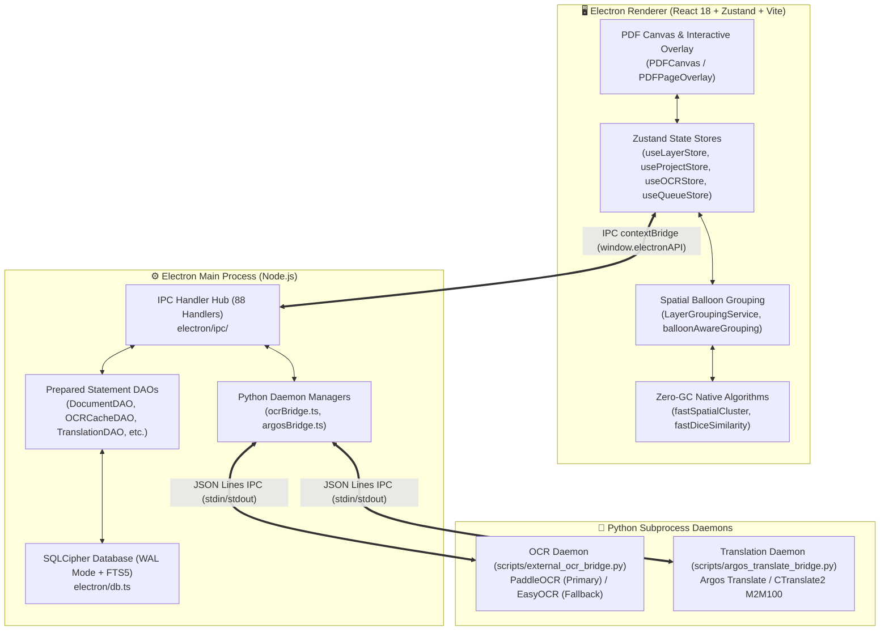
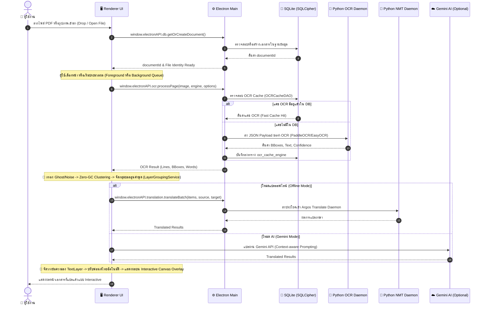
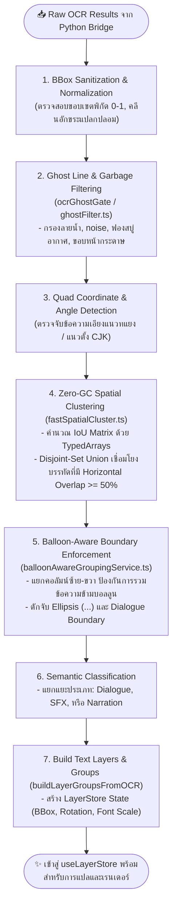
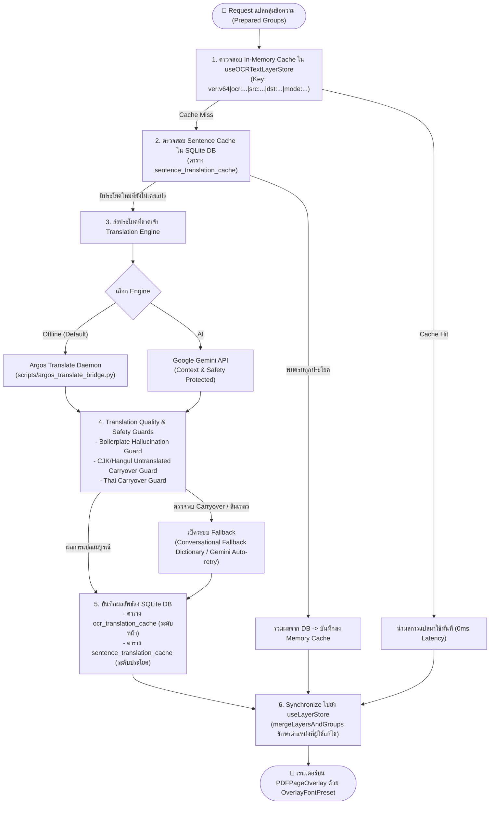
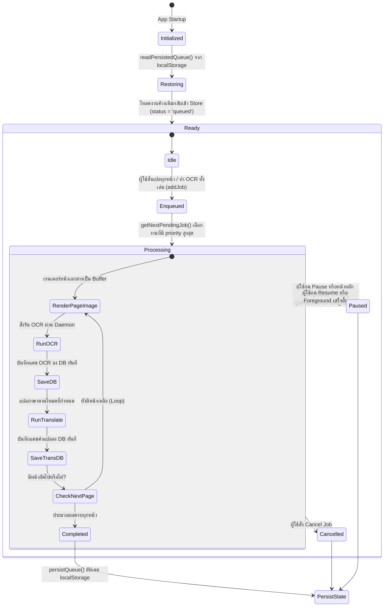
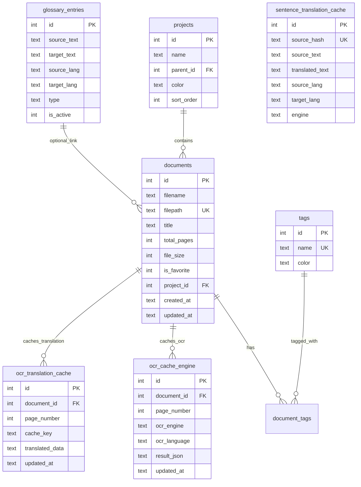

# 🏛️ Master System Architecture & Process Flowcharts

> **Last Updated:** 2026-09-08  
> **Status:** Synchronized with [context.md](file:///c:/App/Electron/PDF_Translator/context.md) & [AI_MANIFEST.md](file:///c:/App/Electron/PDF_Translator/documents/AI_MANIFEST.md)  
> **Test Suite:** 31 Test Files / 372 Tests (100% Passing) | Strict TypeScript Clean

---

## 📌 1. Executive Summary & Core Principles

**PDF Translator** เป็น Desktop Application ประสิทธิภาพสูงที่ออกแบบมาสำหรับการแปลเอกสารและหนังสือการ์ตูน (Manga / Manhwa / Comic) โดยผสานสถาปัตยกรรม 3 ชั้น (Electron Renderer + Node.js Main Process + Python IPC Daemons) เพื่อตอบสนองความต้องการด้านความเร็ว ความแม่นยำ และความเป็นส่วนตัว:

1. **Spatial Graph Clustering:** จัดกลุ่มกล่องข้อความ 2 มิติ (Speech Balloons) ป้องกันการรวมข้อความข้ามช่องคำพูดและแยกแยะประเภท Dialogue, SFX, และ Narration
2. **Zero-GC High-Throughput Algorithms:** อัลกอริทึม Disjoint-Set Union บน `Int32Array` ([fastSpatialCluster.ts](file:///c:/App/Electron/PDF_Translator/src/services/native/fastSpatialCluster.ts)) และ 65,536-bit Bitset Bigram Popcount ([fastDiceSimilarity.ts](file:///c:/App/Electron/PDF_Translator/src/services/native/fastDiceSimilarity.ts)) ป้องกัน Garbage Collection Pauses
3. **Encrypted Local Storage:** ฐานข้อมูลระดับ Local ด้วย SQLCipher (256-bit AES) ผ่าน `better-sqlite3-multiple-ciphers` พร้อม WAL journal mode, 128MB Memory-mapped I/O, FTS5 Full-text Search, และ Prepared Statement Cache
4. **Offline IPC Daemons:** ไปป์ไลน์ OCR และ NMT ทำงานแบบ Subprocess Long-running Daemons ผ่าน JSON Lines IPC ([external_ocr_bridge.py](file:///c:/App/Electron/PDF_Translator/scripts/external_ocr_bridge.py) สำหรับ PaddleOCR/EasyOCR และ [argos_translate_bridge.py](file:///c:/App/Electron/PDF_Translator/scripts/argos_translate_bridge.py) สำหรับ Argos Translate)

---

## 🏗️ 2. System Topology & Process Boundaries



---

## 🔄 3. End-to-End Processing Flowcharts

### 3.1 ภาพรวมกระบวนการทำงานทั้งระบบ (Full Lifecycle Flowchart)



---

### 3.2 กระบวนการจัดกลุ่มข้อความและบอลลูนคำพูด (OCR & Spatial Layout Reconstruction)



---

### 3.3 กระบวนการแปลภาษาและลำดับชั้นของแคช (Multi-Tier Translation Flow)



---

### 3.4 สถาปัตยกรรมคิวงานเบื้องหลัง (Background Queue Processor Lifecycle)



---

## 🗄️ 4. Data Layer & SQLite Schema Architecture

ฐานข้อมูลใช้ **SQLCipher 256-bit AES** โดยเปิดใช้งาน **WAL (Write-Ahead Logging)** และ Memory-Mapped I/O 128MB เพื่อรองรับ Concurrency สูงระหว่าง Foreground Canvas และ Background Queue:



---

## ⚡ 5. Native & High-Performance Optimization (Zero-GC)

ใน Hot Paths ที่ต้องวนลูปคำนวณมากกว่า 10,000 ครั้งต่อหน้าเอกสาร ระบบหลีกเลี่ยงการสร้าง JavaScript Objects ใน Heap เพื่อขจัดปัญหา V8 Garbage Collection Stutter:

### 5.1 Zero-GC Connected Components ([fastSpatialCluster.ts](file:///c:/App/Electron/PDF_Translator/src/services/native/fastSpatialCluster.ts))
- ใช้ `Int32Array(n)` ทำ Disjoint-Set Union (Union-Find) พร้อม Path Compression
- Transitive Closure มีความซับซ้อนระดับ $O(N \cdot \alpha(N))$ โดย $\alpha$ คือ Inverse Ackermann Function
- ไม่มีการสร้าง Array หรือ Queue ชั่วคราว (Typed Buffer Pool ถูกนำกลับมาใช้ซ้ำ 100%)

### 5.2 65,536-bit Typed Bitset Similarity ([fastDiceSimilarity.ts](file:///c:/App/Electron/PDF_Translator/src/services/native/fastDiceSimilarity.ts))
- ใช้ Bitset Pool ขนาดคงที่ `Uint32Array(2048)` รองรับ Space ได้ถึง 65,536 Bigram Hashes
- คำนวณความเหมือนของข้อความ (Sørensen–Dice Coefficient) โดยใช้ **Brian Kernighan's popcount** บน bitwise AND (`a & b`)
- ใช้สมการ Hash: `((char1 * 31) ^ char2) & 0xFFFF` เพื่อรองรับรหัสภาษาไทย (`\u0E00-\u0E7F`) และ CJK โดยไม่เกิด Hash Collision

---

## 🏷️ 6. Versioning Contracts & System Keys

| สัญญาข้อมูล (Contract) | ค่าเวอร์ชันปัจจุบัน | แหล่งอ้างอิงความจริง (Source of Truth) |
|---|---|---|
| **Translation Cache Version** | `v64` | `OCR_TRANSLATION_CACHE_VERSION` ใน [useOCRTextLayerStore.ts](file:///c:/App/Electron/PDF_Translator/src/stores/useOCRTextLayerStore.ts) |
| **OCR Algorithm Version** | `230` | `OCR_ALGORITHM_VERSION` ใน [ocrVersion.ts](file:///c:/App/Electron/PDF_Translator/src/services/vision/ocrVersion.ts) |
| **OCR Raw Engine Version** | `7` | `OCR_RAW_VERSION` ใน [ocrVersion.ts](file:///c:/App/Electron/PDF_Translator/src/services/vision/ocrVersion.ts) |

### รูปแบบโครงสร้าง Cache Key
```text
ver:v64|ocr:paddleocr|ocrLang:eng|src:en|dst:th|mode:manga|translator:offline
```
- ระบบจะยอมรับเฉพาะแคชที่ `ver:v{N}` โดยที่ $N \ge 40$ เท่านั้น แคชเวอร์ชันเก่ากว่าจะถูก Invalidate อัตโนมัติ
- แคชของแต่ละ Engine ถูกแยกออกจากกันในระดับ Database Partitioning ทำให้การล้างแคช Engine หนึ่งไม่กระทบแคชของ Engine อื่น
